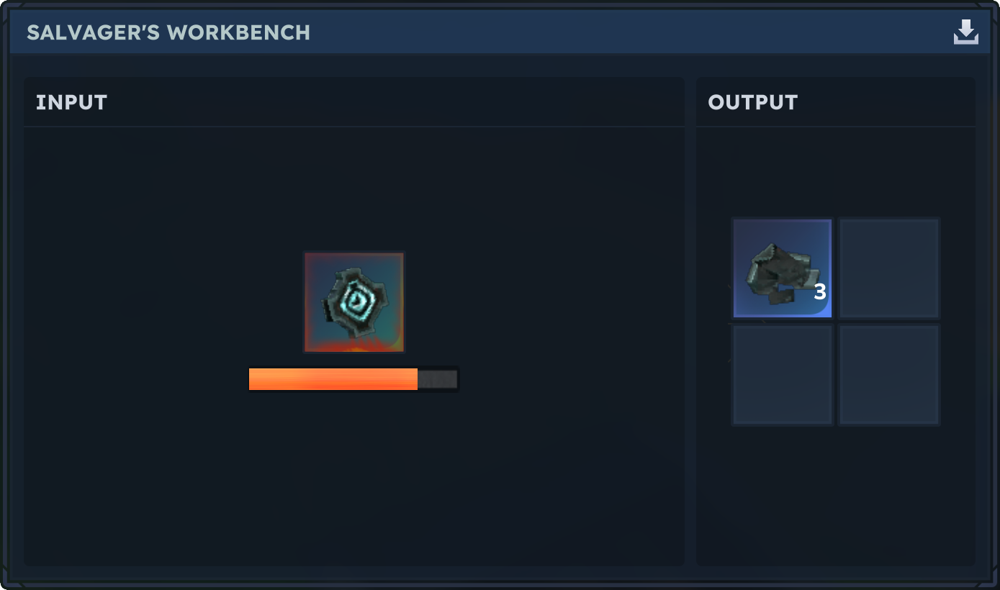

# Rune Salvage

Adds **salvage recipes for runes** so you can break unwanted runes back down into **Rune Shards** at the Salvage Bench.

---

## Features

- Salvage any of the 15 runes at the Salvage Bench (4 seconds per rune)
- Rune Shard yield depends on the rune: Chain Hook, Charged Shot, Enrage, Fireball, Ground Slam, Poison Imbue and Wind Strike return 2, the rest return 1
- Data pack only: no code, no commands, no configuration

## Salvageable runes

Aoe Up, Chain Hook, Charged Shot, Duration Up, Enrage, Fireball, Fork, Ground Slam, Poison Imbue, Quickening, Rend, Ricochet, Thrift, Wind Strike, Wither

## Installation

1. Download the latest `RuneSalvage-<version>.zip` from the releases page
2. Put the zip in your server's `mods` folder
3. Restart the server

---

# Contributing

Suggestions, ideas, and feedback are welcome.

---

# Socials

### X: [@MarggxDev](https://l.marggx.dev/x)

### Discord: [Marggx](https://l.marggx.dev/discord)

### Reddit: [Marggx](https://l.marggx.dev/reddit)

### YouTube: [Marggx](https://l.marggx.dev/yt)

### Patreon: [Marggx](https://l.marggx.dev/patreon)
